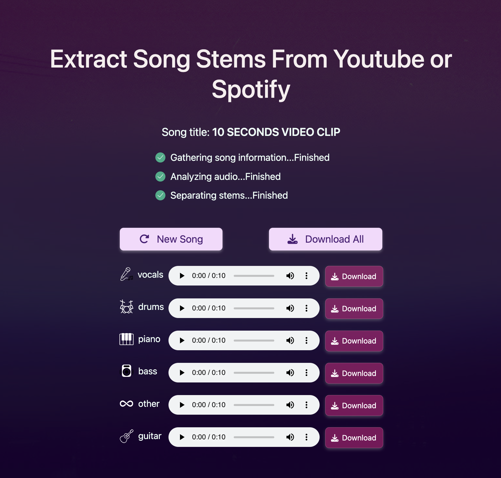

# StemStream

## Extract the "stems" (e.g. drums, vocals, bass) from any song on Spotify or Youtube into separate audio files

## Introduction

This is a Flask web app using the following resources:

- [Demucs ML model](https://github.com/facebookresearch/demucs): Demucs is an music source separation model that creates the stems
- [yt-dlp](https://github.com/yt-dlp/yt-dlp): Extracts the audio from the YouTube videos before passing them into demucs.
- [Spotify API](https://developer.spotify.com/documentation/web-api) & [Youtube Data API](https://developers.google.com/youtube/v3) for URL conversion

## Screenshot



## Installation

0. Install Python 3.8 or higher

1. Clone the repository: Open a terminal and clone the repository using the following command:

   ```bash
   git clone https://github.com/otonomee/streamstem.git
   cd streamstem
   ```

2. Install dependencies: Navigate to the project directory and install the required dependencies:

   ```bash
   pip install -r requirements.txt
   ```

3. **Set up environment variables** (Required for Spotify URL conversion):

   a. Copy the example environment file:
   ```bash
   cp .env.example .env
   ```

   b. Edit `.env` and add your API credentials:
   ```
   SPOTIFY_CLIENT_ID=your_spotify_client_id_here
   SPOTIFY_CLIENT_SECRET=your_spotify_client_secret_here
   GOOGLE_API_KEY=your_google_api_key_here
   ```

   **How to get API credentials:**
   - **Spotify API**: Register at [Spotify Developer Dashboard](https://developer.spotify.com/dashboard) to get Client ID and Secret
   - **Google YouTube API**: Create a project at [Google Cloud Console](https://console.cloud.google.com/apis/credentials) and enable YouTube Data API v3

   **Note**: API credentials are only required if you want to use Spotify URLs. YouTube URLs work without any API keys.

4. Run the web app: Start the web app by running the following command:

   ```bash
   python application.py
   ```

5. Access the web app: Open your web browser and go to [http://localhost:8001](http://localhost:8001) to access the web app.

## Usage

1. Enter the YouTube video URL: On the web app's homepage, enter the URL of the YouTube video you
   want to convert the audio from.

2. Select the number of stems you'd like:

   - 2 stems: vocals and instrumental
   - 4 stems: vocals, drums, bass, other
   - 6 stems: vocals, drums, bass, guitar, piano, other

3. Select desired output format

4. Hit Submit and wait a few minutes. Download prompt will appear when finished :)
